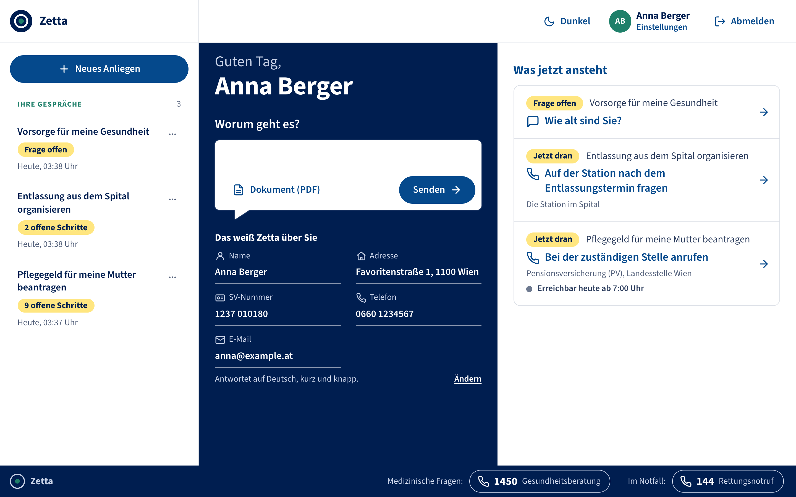
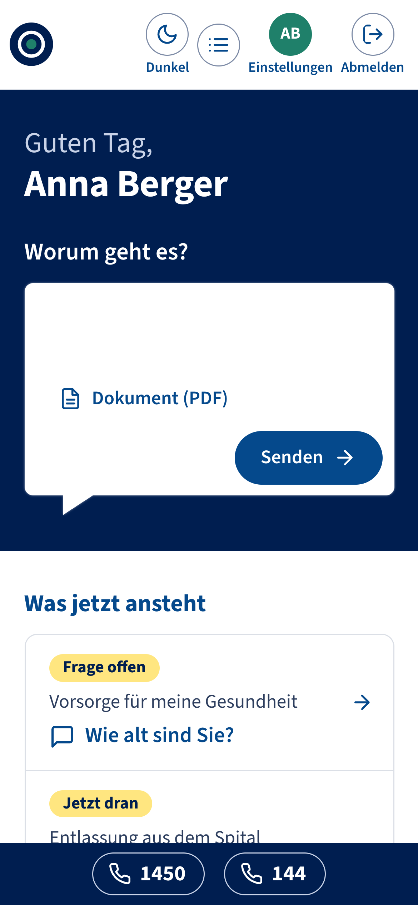
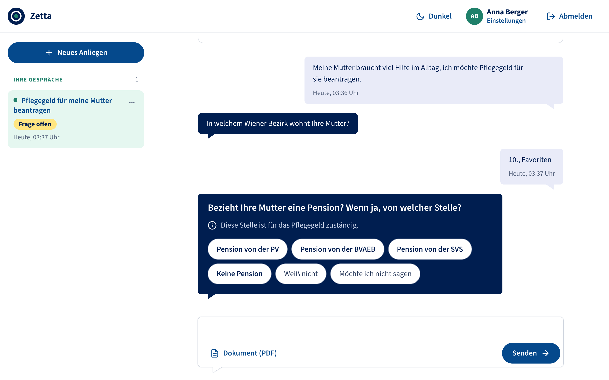
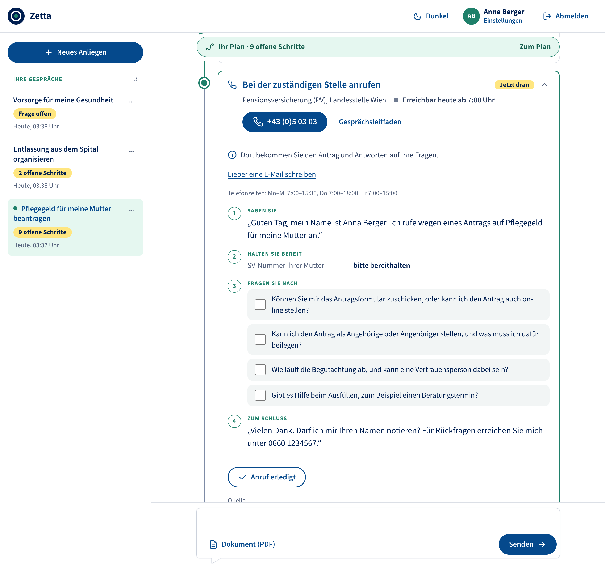
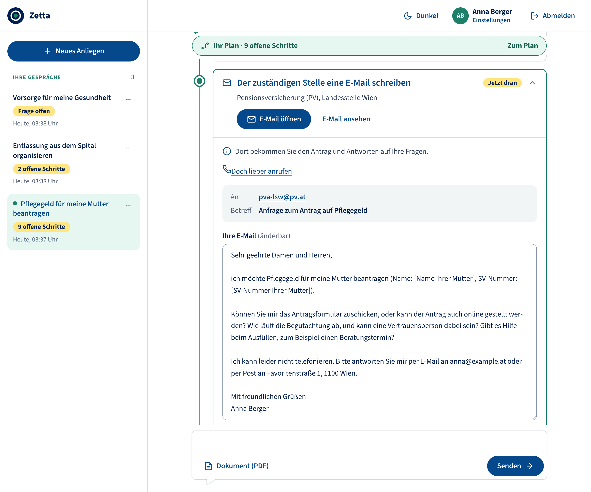
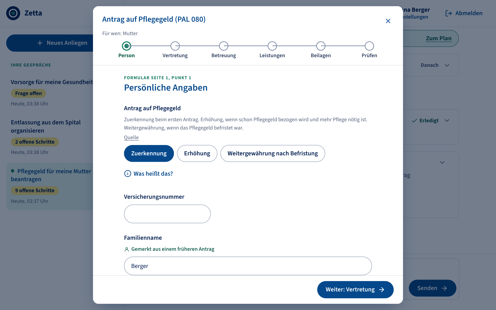
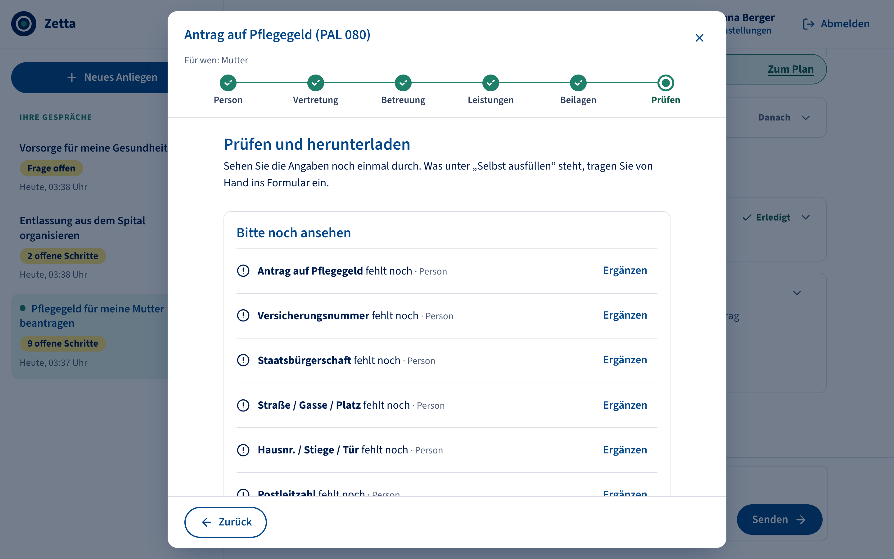
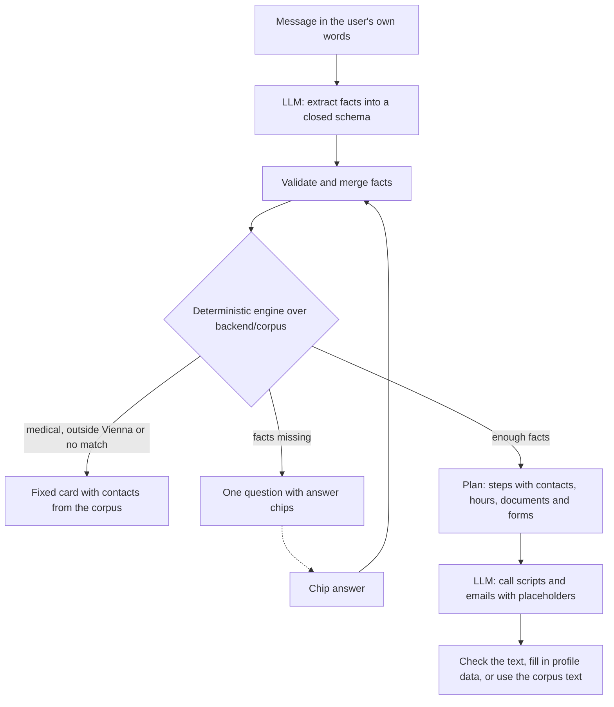
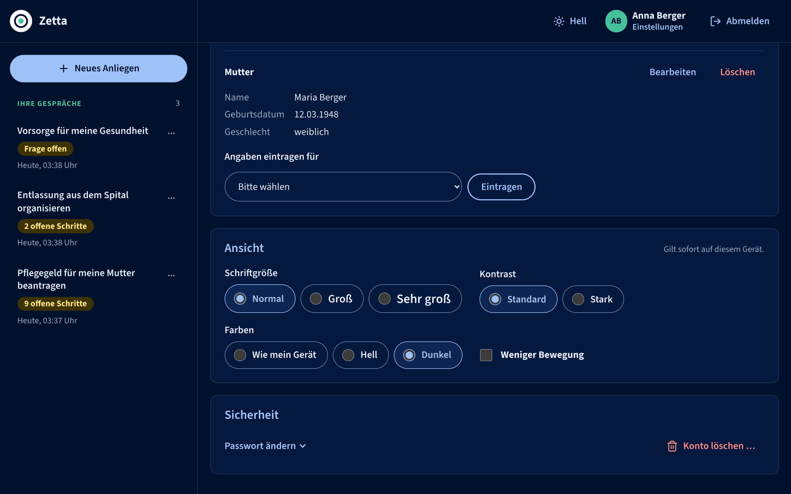

<p align="center">
  <picture>
    <source media="(prefers-color-scheme: dark)" srcset="docs/assets/logo-dark.svg">
    
  </picture>
</p>

<h1 align="center">Zetta</h1>

<p align="center">
  An AI guide to Austrian social insurance and care services in Vienna that turns a worry into the next concrete steps.
</p>

<p align="center">
  <a href="#what-it-does">What it does</a> ·
  <a href="#how-it-works">How it works</a> ·
  <a href="#run-it-locally">Run it</a> ·
  <a href="#docs">Docs</a>
</p>

<p align="center">
  
</p>

<p align="center"><sub>The home view. „Was jetzt ansteht“ shows what each conversation needs next: an open question, or the step that is due, with the institution and when it takes calls.</sub></p>

Zetta was built for the DVSV KI-Challenge. People describe their situation in their own words, often about someone else: a mother who needs help at home, a father who is about to leave hospital, a child. Zetta asks only what it still needs to know and then lays out a plan: whom to call and when, what to say, which email to send and which form to fill in. It does not answer with a wall of text.

Zetta covers Vienna and these topics: care (Pflege), follow-up after a hospital stay, check-ups, vaccinations, children, doctor's appointments and minimum income support (Wiener Mindestsicherung).

## What it does

<table>
  <tr>
    <td valign="top">
      <h3>1. Describe</h3>
      <p>Write it the way you would tell a friend: „Meine Mutter braucht viel Hilfe im Alltag, ich möchte Pflegegeld für sie beantragen.“ You can also attach a discharge letter as a PDF.</p>
      <p>Zetta reads the letter only for recommendations about applications and support. Each one is shown with the sentence it was taken from, checked against the letter, and you confirm it before it counts. Findings and diagnoses are ignored, and the letter is not stored.</p>
    </td>
    <td width="300" valign="top">
      
    </td>
  </tr>
</table>

### 2. Answer

Zetta asks one question at a time, with answer chips and a short note on why it asks. A chip sets the fact directly. „Weiß nicht“ counts as an answer, and after at most four questions Zetta builds the plan with what it knows. What it understood stays visible above the plan („Verstanden“) and can be changed there.

<p align="center">
  
</p>

### 3. Get a plan

The plan is a line of steps per topic. The current step says „Jetzt dran“. A call step shows the number, the phone hours and whether the line is open now, plus a call script with your details already filled in: what to say, what to have ready, what to ask and how to close. An email step comes as a finished email to open in your mail program or copy. Some call steps can be switched to an email instead.

<table>
  <tr>
    <td width="50%" valign="top"></td>
    <td width="50%" valign="top"></td>
  </tr>
  <tr>
    <td align="center"><sub>Call script, filled in from the profile.</sub></td>
    <td align="center"><sub>The same step as an email. Missing details show as visible gaps.</sub></td>
  </tr>
</table>

### 4. Act

Form steps open a wizard that walks through the official PDF form one section at a time, in the form's own wording: Pflegegeld (PAL 080), the FSW application, rehabilitation, and the transport cost subsidy. Answers already known from the profile, earlier forms or the conversation are prefilled and say where they came from. The review lists what is still missing, then you download the filled-in PDF. Zetta never fills in health details, consents, the date or the signature.

Done steps are checked off, calls can record an outcome („Nicht erreicht“ keeps the step open), and „Was jetzt ansteht“ moves on to the next step.

<table>
  <tr>
    <td width="50%" valign="top"></td>
    <td width="50%" valign="top"></td>
  </tr>
  <tr>
    <td align="center"><sub>One section per screen, with the page and point of the paper form.</sub></td>
    <td align="center"><sub>The review before the download.</sub></td>
  </tr>
</table>

## How it works



The engine is plain Python over curated YAML in `backend/corpus/`: institutions, services, questions, forms and fixed cards. It decides which services apply, which question comes next, whether a service „kommt in Frage“ (never „Sie haben Anspruch“), and which steps the plan has. Institutions, services and forms each carry a source URL and a verification date, and the step cards link to their source.

The LLM (Azure OpenAI by default, or any OpenAI-compatible server) has narrow jobs: turning free text into facts from a fixed list, writing a chat title and a one-line plan intro, wording call scripts and emails, finding recommendations in a discharge letter, and, on request, helping with a form question. It never chooses a question or a service, and it never supplies a phone number, opening hours, an address or a document list. A script is rejected if it contains phone numbers, email addresses, links, dates, amounts or medical terms; Zetta then uses the corpus text. Chip answers skip the LLM, so without it the chips and corpus scripts still lead to a plan.

## Privacy and safety

- **No medical advice.** Medical questions get a fixed card that points to the Gesundheitsberatung 1450 and, in an emergency, the Rettungsnotruf 144. The fact schema has no field for diagnoses or symptoms, and the form help refuses questions about illnesses.
- **Profile data never reaches the LLM.** Name, address, social security number, phone and email live in the profile. The LLM writes placeholders such as `{user.name}` and the backend fills them in. Before free text or a letter goes to the LLM, social security numbers and email addresses are removed, and in letters dates too.
- **Off-topic messages** get a short fixed reply that says what Zetta can help with, not a free answer.
- **Limits.** Each user can make 60 turns and 10 uploads per hour. Letters are read from text-based PDFs of up to 30 pages.

Details are in the [security review](docs/security-review.md).

## Accessibility and languages

The interface is available in German, English, French, Czech, Slovak and Slovenian. Translations are made ahead of time and checked, never at runtime. Call scripts and emails stay in German, because that is what the office hears and reads; in another language the translation is shown below.

Text size has three steps (Normal, Groß, Sehr groß), and there is a dark mode, a high-contrast mode and a setting for less motion. The design system asks for at least 4.5:1 text contrast in every theme and for status in words, not only in colour. See the [design system](docs/design.md).

<p align="center">
  
</p>

## Run it locally

You need Docker, or [uv](https://docs.astral.sh/uv/) and Node.js (22.18+ or 24.12+) to run without it.

Create `backend/.env` with a random `JWT_SECRET`:

```sh
cd backend
uv run scripts/generate_env.py
```

Then set `LLM_API_KEY` in `backend/.env`. To use another OpenAI-compatible server, set `LLM_BASE_URL` and `LLM_MODEL` as well; a local server usually needs no key. The other settings are listed in [`backend/.env.example`](backend/.env.example). Never commit `.env`.

Start both services from the repository root:

```sh
docker compose up
```

The app runs on http://localhost:5173 and the API on http://localhost:8000. Both ports are bound to `127.0.0.1` only.

Without Docker, in two terminals:

```sh
cd backend && uv run backend               # API on http://localhost:8000
cd frontend && npm ci && npm run dev       # app on http://localhost:5173
```

## Development

```sh
cd backend && uv run pytest                # API, engine tables, corpus checks, eval sets
cd frontend && npm test                    # node:test
cd frontend && npm run build               # type check and production build
```

After changing a text in the corpus or the frontend, run `uv run scripts/translate.py` in `backend/`. It sends only new or changed texts to the LLM and updates `frontend/src/locales/`. `tests/test_translations.py` fails until every text has a checked translation.

```
backend/
  corpus/           institutions, services, questions, forms, cards (YAML), official PDF forms
  src/backend/      FastAPI app: engine, pipeline, LLM client, scripts, forms, routers
  scripts/          generate_env.py, translate.py, import_doctors.py
  tests/            pytest, with scenario sets in tests/eval/
frontend/
  src/components/   chat, plan, step cards, form wizard, settings
  src/locales/      en, fr, cs, sk, sl
docs/               product spec, response system, design system, security review
compose.yaml
```

Stack: Vue 3, Vite and TypeScript in the frontend; FastAPI, SQLAlchemy and SQLite in the backend, managed with uv; docker compose for the dev setup.

## Docs

- [Presentation overview](docs/presentation.md): example use cases, privacy, safeguards and limits
- [Product spec](docs/README.md): the idea and the scope
- [Response system](docs/response-system.md): pipeline, fact schema, engine, step graph and evaluation
- [Design system](docs/design.md): colour roles, type, patterns
- [Security review](docs/security-review.md): findings and fix status
- [Backend](backend/README.md): API layout and commands
- [AGENTS.md](AGENTS.md): commit and branch rules
